# 全域实体关系草图

关联 #69；日期 2026-10-24；状态：设计草案，待 M1/M3/M4/M5/M6 共同评审。
本批已整合40表参考物理结构并在临时PG验证；图不代表应用迁移已合入。完整字段/FK和删除规则见[结构清单](../database-design/schema.json)与[参考DDL](../database-design/schema.sql)，新增class快照、版本与账本规则见[决定](../database-design/decisions.md)。
`turn_citations` 中 citation_id 是轮内编号，候选键为(turn_id,citation_id)，不是全局实体ID。

```mermaid
erDiagram
    users ||--o| user_profiles : has
    users ||--o{ user_roles : assigned
    roles ||--o{ user_roles : defines
    users ||--o{ auth_sessions : opens
    roles ||--o{ auth_sessions : role_snapshot
    users o|--o{ admin_audit_logs : acts
    users o|--o{ system_config_versions : publishes
    users ||--o{ enrollments : joins
    classes ||--o{ enrollments : contains
    users ||--o{ teaching_assignments : teaches
    classes ||--|{ teaching_assignments : assigns
    courses ||--o{ classes : offers
    courses ||--o{ chapters : divides
    courses ||--o{ assignments : owns
    classes o|--o{ assignments : scopes
    assignments ||--o{ submissions : receives
    users ||--o{ submissions : submits
    users ||--o{ mistakes : collects
    submissions o|--o{ mistakes : originates
    users ||--o{ study_plans : owns
    study_plans ||--o{ plan_items : includes
    users ||--o{ reminders : receives
    users ||--o{ tutoring_sessions : owns
    tutoring_sessions ||--o{ tutoring_turns : includes
    tutoring_turns ||--o{ turn_citations : cites
    prompt_versions ||--o{ tutoring_turns : generates
    model_config_versions ||--o{ tutoring_turns : configures
    courses ||--o{ documents : owns
    documents ||--o{ document_chunks : contains
    documents ||--o{ document_import_jobs : imports
    documents ||--o{ document_grants : authorizes
    users ||--o{ document_grants : receives
    documents ||--o{ turn_citations : referenced
    users ||--o{ avatar_profiles : configures
    avatar_config_versions ||--o{ avatar_profiles : versions
    users ||--o{ focus_sessions : studies
    tutoring_turns o|--o{ playback_records : narrated
    users ||--o{ media_assets : uploads
    media_assets ||--o{ media_jobs : processes
    users ||--o{ learning_events : acts
    courses o|--o{ learning_events : scopes
    learning_events ||--o{ analytics_processed_events : applied
    analytics_consumers ||--o{ analytics_processed_events : tracks
    analytics_consumers ||--o{ analytics_quarantined_events : isolates
    learning_events ||--o{ analytics_quarantined_events : rejects
    classes ||--o{ analytics_daily_metrics : aggregates
    users ||--o{ report_jobs : requests
    report_jobs ||--o{ analytics_report_snapshots : produces
```

## owner必须确认的边界

- M1：用户状态/角色分配/会话撤销跨重启；admin不是前端菜单，必须有服务端授权和审计。
- M5：course/class分离；一个教学班至少一个主讲关系由事务保证，未完成创建事务不可对外可见；学生可加入同课程多个班。
- M3：document_grants图先表示用户授权，班级授权如何归一化须与M5确认；不能一个不受外键约束的target_id隐式混装多种实体。
- M3：引用保留文档版本、页码和原文定位。删除课件、会话与引用的保留规则应明确；不可无条件级联删除后伪称历史可溯源。
- M4：media_assets保存对象存储key和元数据，不保存密钥；profile到配置版本关系不可覆盖历史。
- M6：事件的class归属尚待#65确认，因此这里刻意未画一条已冻结class外键；需为同课程多班、转班、无class事件提交方案。
- M6：analytics_processed_events使用(consumer,event)唯一关系，聚合与处理账本同事务；“identity=提交顺序”不成立。
- 学习事件仅追加；历史错误通过更正记录/重放修正，不能删除事件制造漂亮统计。
- 跨模块访问走公开服务/契约；物理FK完整性不等于允许直接写其他领域表。
